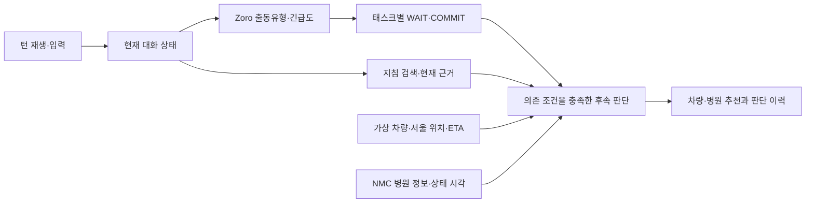

# SENTINEL119 프로젝트 명세 v0.2

작성: 2026-11-19 / 마감: 2026-11-20 09:00 KST.

상태: 구현 전. **확정 범위**는 사용자 답변을 반영한다. 나머지는 완성을 위한 **구현 기본안**이며, 실제 성능·호환성·임상 타당성을 검증했다는 뜻이 아니다. 화면 기준은 [DESIGN.md](../DESIGN.md)에 둔다.

Track 1의 공식 평가·제출 요건은 [평가 기준과 제출 체크리스트](track1-submission.md)를 따른다. 주최 측 안내자료를 확인해 v0.2에 반영했다.

## 1. 목적과 확정 범위

프로젝트 배경: 응급환자 이송 지연 문제를 줄이기 위해, 신고 단계의 정보와 구급 자원·병원 수용 정보를 연결하는 관제 의사결정 보조를 개발한다. 현재 목표는 이송 후보의 탐색·비교 흐름을 시뮬레이션으로 구현하는 것이며 실제 이송 지연 감소 효과는 미검증이다.

한 문장 목표: **신고 대화가 들어올 때마다 판단 가능한 태스크를 먼저 확정하고, 부족한 정보는 기다리면서 구급 자원·병원 후보를 갱신하는 관제 시뮬레이터.**

| 항목 | 확정 내용 |
| --- | --- |
| 인원·기한 | 2명, 2026-11-20 09:00 KST |
| 입력 | 텍스트 턴 재생을 먼저 완성; 음성 입력은 확장 |
| 분류 | 화재 / 구조 / 구급 / 기타 유지, 긴급도 상 / 중 / 하 |
| 시나리오 | 구급에 집중, 서울 지역 |
| 모델·환경 | Zoro-1, NVIDIA Brev, 100달러 크레딧, L40S 우선 검토 |
| 접근 | 사용자가 Zoro 다운로드 허가를 받음; 실행 환경은 미확인 |
| 학습 | SFT 기준선 우선, PPO는 꼭 시도할 추가 실험이며 제출 필수는 아님 |

구현 기본안은 한 번에 단일 신고·차량 한 대 추천이다. 다중 신고 배차 최적화, 복수 차량 동시 출동, 실제 병원 수용 요청, 음성모델 학습은 이번 필수 범위에 넣지 않는다. 실제 구급대 자원과 가용성은 확보되지 않았으므로 차량 세계는 명시적으로 가상이다.

### Track 1 평가 반영

공식 평가는 창의성 50점(실제 적용 가능성·사업화), 완성도 50점(목표 달성 15·오류 시에도 동작 15·라이브 데모 15·발표 5)이다. **System 1 판단에 Zoro-1 사용이 필수**이므로 실제 모델 판단과 결과 적용을 화면·로그에서 연결한다. 자체 정확도·지연 지표나 SFT/PPO 실험을 공식 배점으로 표현하지 않는다.

제출 완료에는 **주최 측 템플릿의 Google Slides 발표자료(5분·5장 내외), GitHub 저장소와 심사위원 초대, 서로 다른 시나리오의 실행 로그 3종, 직접 확인 가능한 데모 링크·QR 등**이 필요하다. 모델 실험보다 전체 동작·오류 대응·실제 접근 가능한 시연과 제출물을 먼저 확보한다.

## 2. 사용 흐름

1. 서울 시나리오를 선택하거나 새 텍스트 세션을 연다.
2. `다음 발화` 또는 직접 입력으로 발화 한 개를 추가한다. 마지막까지 자동 재생도 지원한다.
3. 현재까지의 대화와 당시의 자원·병원 상태만 모델에 전달한다.
4. 출동유형·긴급도를 함께 판단하고, 태스크별 WAIT/COMMIT을 결정한다.
5. 필요한 조건이 갖춰진 태스크에서 차량과 병원 후보를 선택한다. 병원 WAIT가 차량 추천을 막지 않는다.
6. 근거 발화, 지침 출처, 선택지별 확률, ETA와 외부 정보 시각을 표시한다.
7. 새 발화·정정·외부 상태 변화가 들어오면 관련 판단을 재평가한다. 이전 결정은 이력에 남긴다.

실제 외부 출동·예약 동작은 없다. `모의 출동 적용`은 화면 안의 차량 상태만 변경한다.

## 3. 의사결정 계약

| 태스크 | 선택 값 | 준비 조건과 기본 동작 |
| --- | --- | --- |
| 출동유형 | 화재 / 구조 / 구급 / 기타 | 현재 대화로 추정; 근거 부족 시 WAIT |
| 긴급도 | 상 / 중 / 하 | AI Hub 긴급도 분류; KTAS·Pre-KTAS와 자동 치환하지 않음 |
| 자원 추천 | 동적 차량 ID / 보류 | 위치·가용성·검증 가능한 필요 역량을 고려; 데모 구급차 A/B가 핵심 |
| 병원 추천 | 동적 병원 ID / 보류 | 위치·필요 역량·API 상태와 ETA를 사용; 상위 3개를 비교 |
| 확정 여부 | 각 태스크의 WAIT / COMMIT | 전역 단일 게이트를 두지 않음 |

분류는 네 종류를 유지한다. 비구급 신고의 상세 배차·이송 흐름은 `상세 시나리오 범위 밖`으로 표시한다. 이를 낮은 긴급도나 병원 WAIT로 잘못 표현하지 않는다. 소방차 C는 자원 카탈로그에 둘 수 있지만 구급차 후보에 포함하지 않는다.

COMMIT은 **현재 정보에서 추천을 채택했다는 이벤트**다. 통화를 종료하거나 이후 판단을 금지하지 않는다. 정정이 오면 활성 추천을 재검토하며 이전 COMMIT을 덮어쓰지 않는다. 모의 출동을 적용한 차량은 모델 재추론만으로 자동 취소·재배차하지 않는다.

각 결과는 최소한 다음을 포함한다.

```text
session_id, turn_id, state_version, model_variant
task, status(WAIT|COMMIT|OUT_OF_SCOPE), choice, probabilities
evidence_turn_ids, guideline_refs, missing_information
candidate_snapshot_id, produced_at, latency_ms
```

`choice`는 WAIT 중에도 잠정 후보로 표시할 수 있지만 채택된 추천과 구분한다. 오류·추론 중 상태는 별도 실행 상태로 표현하며 COMMIT으로 취급하지 않는다. 확률은 모델 출력이며 119에서 검증된 신뢰도로 표현하지 않는다. `state_version`이 지난 응답은 활성 화면에 반영하지 않는다.

## 4. 시스템 기본안



- 백엔드: Python/FastAPI, 명시적 세션 상태와 JSON 결과. 초기에는 메모리 세션·JSONL 이력으로 충분하다.
- 프론트엔드: React/Vite/TypeScript 기본안. 기존 `ermct-backend`의 관련 컴포넌트·API 어댑터만 선별 재사용한다. 기존 저장소는 수정하지 않는다.
- 모델: Brev의 Zoro direct decision 경로를 먼저 연결한다. 현재 상태가 같은 질문은 하나의 요청으로 묶고, 앞선 결과에 의존하는 질문은 다음 단계에서 처리한다.
- 길고 자동적인 reasoning은 첫 데모 경로에서 제외한다. 설명은 근거 발화·문서·후보 속성에 연결한다.
- 지침 검색: 선별한 챕터·알고리즘을 키워드/BM25 방식으로 검색하는 작은 인덱스부터 시작한다. 벡터DB는 필수 아님.
- 위치: 현재 발화에서 확인했거나 사용자가 명시적으로 제공한 위치만 사용한다. 시나리오 고정 좌표는 `데모 제공 위치`로 표시한다.
- 모델 추론 실패를 정해진 추천으로 감추지 않는다. 저장된 실행을 재생할 경우 `기록 재생`이라고 표시한다.
- 원본 실험 로그와 별도로, 실제 모델 요청·정책·도구 결과를 연결한 제출용 실행 로그를 내보낸다. 공유할 JSONL은 `docs/submission/logs/`에 두고 검토 후 Git으로 추적한다.

Zoro의 공식 decision-only 학습 경로는 확인했지만, 현 체크포인트의 단일 L40S 학습·LoRA·커스텀 head 호환성은 미검증이다. 모델과 upstream revision을 첫 실행에서 고정한다.

## 5. 지침·자원·병원 세계

### 지침

실제 구조화 지식 경로는 `C:/Users/jaeuk/Project/prehospital-synthetic-data/data/knowledge`이다. `prehospital-dictation-sim`은 이 자료를 참조한다. 샘플 `alg-01-p584.yaml`의 상태는 `draft`였다. 전체 지침이 검증됐다고 가정하지 않는다.

사용할 조건마다 원본 2023 PDF의 문서명·인쇄 쪽·PDF 쪽·근거 문구를 보존한다. 데모에 필요한 구급대 편성·자원 역량·이송 관련 조건을 먼저 원문과 대조한다. 자격 등급만으로 모든 처치 가능성을 추정하지 않는다. 이 PDF는 선택한 데모 근거 버전이며 최신 운영 지침이라고 주장하지 않는다.

### 가상 자원

차량 데이터: `id`, `vehicle_type`, `crew[{qualification, capabilities}]`, `equipment`, `available`, `location`, `eta_seconds`, `eta_source`.

가용성·차종 등 검증 가능한 강제 조건은 서버가 적용하고 Zoro는 남은 후보를 비교한다. 임상 역량 제한은 현재 발화 근거와 원문 대조가 된 규칙이 있을 때만 적용한다. 필요 역량이 불명확한 경우 불명 상태를 유지한다. 후보에 적합한 차량이 없으면 보류한다.

A/B의 위치·역량·가용성을 바꾸면 추천이 달라지는 장면을 만든다. 고정 ID 선호를 막기 위해 학습·평가에서 후보 순서와 표시 이름을 바꾼다. 특정 자격 조합의 실제 법적 업무 범위는 별도 확인 없이 단정하지 않는다.

### 병원·ETA

기존 `ermct-backend`의 NMC client, 병원 스키마, 메시지·중증질환 수용정보 처리, Tmap 경로 코드를 재사용 후보로 한다. 기존 추천 엔진의 결과를 Zoro 추천으로 표시하지 않는다. Zoro가 실제로 평가한 후보·입력·출력을 기록한다.

병원 상태에는 `가능 / 불가 / 정보 없음`, 원천 시각, 수집 시각을 보존한다. 병상 수만으로 특정 수술 가능성을 판단하지 않는다. 정보 없음과 API 실패를 불가 또는 가능으로 바꾸지 않는다. 수용정보는 후보 선정 근거이며 실제 환자 수용 확정과 구분한다.

API 연결이 안 되면 출처와 수집 시각이 있는 저장 응답을 사용한다. 저장 응답도 없으면 합성 병원을 사용하되 `가상 병원`으로 표시한다. 실제 API의 현재 상태와 가상 값을 섞어 실제 현황으로 제시하지 않는다. Tmap이 없으면 시나리오 ETA를 쓰고 `가상 ETA`로 표시한다.

## 6. 데이터와 학습

### 데이터 구성

AI Hub 71768의 `utterances`와 통화 단위 `disasterLarge`, `urgencyLevel`을 사용한다. 표본에서 `symptom`, `triage`는 비어 있었으므로 존재만으로 유효 정답이라고 가정하지 않는다.

1. `recordId`와 중복 내용으로 통화를 묶고 **통화 단위로 먼저 분할**한다. 같은 통화의 모든 prefix·변형은 같은 split에 둔다.
2. 공식 Training에서 학습·개발을, 공식 Validation에서 최종 평가 표본을 만든다. 통화 중복을 확인한다. 개발셋으로 임계값·모델을 고르고 평가셋은 선택에 사용하지 않는다.
3. 입력은 현재까지의 발화만 포함한다. 정답 라벨, 통화 전체 주소·증상, 미래 발화와 미래 병원 상태를 입력에 넣지 않는다.
4. 화자 코드와 발화 시간 순서를 표본으로 검증한다. 원본 타임스탬프와 turn ID를 보존한다.
5. 최초 로드·학습 확인은 100통화로 시작한다. 본 실험 목표 상한은 학습 2,000 / 개발 300 / 평가 500통화다. 확보된 클래스·긴급도 분포에 따라 실제 수량과 누락을 기록한다.

통화 최종 라벨은 전체 대화 분류에 사용할 수 있지만 모든 prefix의 확정 정답으로 복제하지 않는다. 조기 확정 평가는 현재 근거로 판단 가능한 시점과 정답을 별도로 검토한 소규모 prefix 세트를 사용한다. 목표는 원본 통화 30개(학습 15 / 개발 5 / 평가 10)이며 검토 수량을 그대로 공개한다. 적은 표본으로 일반 성능을 주장하지 않는다.

자원·병원 선택은 별도 합성 세계 정답이다. 시나리오의 잠재 사실과 턴별 공개 정보를 분리하며 정답 생성에 사용한 미래 사실을 모델에 노출하지 않는다. 템플릿·원본 사례 단위로 분할하고 동일 템플릿 변형의 평가 누출을 확인한다.

### 비교 모델

| 이름 | 학습·평가 범위 |
| --- | --- |
| Base | 원본 Zoro decision head + 개발셋에서 정한 WAIT 정책 |
| SFT | 출동유형·긴급도의 지도 적응 + 같은 계열의 WAIT 정책 |
| SFT + PPO gate | 선택한 SFT 체크포인트를 고정하고 별도 WAIT/COMMIT 정책 학습 |

SFT는 선택지 확률에 대한 지도 손실을 우선한다. 첫 smoke에서 decision head 로드·gradient·저장·재로드를 확인한 후 지원 가능한 adapter 범위를 결정한다. 전체 모델 학습을 기본값으로 두지 않는다. 호환성 문제로 head만 학습하면 결과를 **head-only 지도 적응**으로 명시하고 LoRA나 전체 모델 SFT를 수행했다고 쓰지 않는다. 생성형 JSON SFT로 바꿀 경우 출력 계약과 실험 이름을 함께 바꾼다.

분류 전용 학습이 차량·병원 판단을 악화시키는지 고정 시나리오로 확인한다. 필요하면 해당 태스크에 원본 head를 유지하고 head별 사용 범위를 실험 기록에 남긴다. 검증 결과가 나쁘면 시연에는 Base를 사용하고 SFT 결과는 실제 수치대로 보고한다.

### PPO 추가 실험

목적은 **분류 결과를 언제 채택할지** 학습하는 것이다. 첫 범위는 출동유형·긴급도의 2-action gate이며 차량·병원 정책까지 확대하지 않는다. Zoro 백본을 PPO로 업데이트하는 실험과 명확히 구분한다.

- 환경: 같은 통화의 현재 prefix를 관찰하고 WAIT하면 다음 턴으로 진행한다. 실제 추가 질문 생성은 하지 않는다.
- 관측: 고정한 Zoro의 현재 선택지 확률·margin·entropy, 태스크 ID, 현재까지의 턴 수·경과 시간, 실제 관찰된 정보 플래그. 최종 통화 길이·미래 정보·정답은 제외한다.
- 행동: WAIT / COMMIT. COMMIT은 해당 태스크 에피소드를 끝낸다. 실제 앱의 이후 정정 처리는 상태 엔진이 맡는다.
- 정책: 작은 actor/critic을 학습한다. 고정 Zoro의 prefix 출력을 캐시하면 PPO 반복 중 백본을 매번 실행할 필요가 없다. 생성 모델용 PPO 도구가 그대로 호환된다고 가정하지 않는다.
- 초기 보상안: 근거가 충분하고 맞는 COMMIT `+1`, 틀린 COMMIT `-4`, 근거 전의 성급한 COMMIT `-4`, 긴급도 하향 오판 `-6`. 중복 패널티는 합산하지 않고 큰 페널티를 택한다.
- WAIT는 아직 판별 불가능하면 `0`, 검토된 준비 시점 이후에는 턴당 `-0.02`. 종료까지 판단하지 않은 경우 준비 시점이 있었다면 `-1`, 끝까지 불명확한 사례의 보류는 `0`.
- 보상 수치는 개발용 가정이다. 임상 손실값이 아니다. 평가셋으로 보상을 맞추지 않는다.

항상 WAIT, 항상 COMMIT, 단순 confidence 임계값과 비교한다. 일찍 맞춘 비율만 보지 않고 근거 전 확정·오판·대기·미확정 비율을 같이 측정한다. PPO가 이기지 못해도 실험 결과를 남기고 검증된 기본 정책을 데모에 유지한다.

실험 상한: 환경 검사 1회, 학습 seed 최대 2개, 설정 변경 1회, 총 90분. 단일 고정 추론 모델과 cached feature를 재사용하며 별도 GPU를 자동 증설하지 않는다. 실패하면 원인·사용 예산·마지막 체크포인트를 남긴다.

## 7. 데모 시나리오와 완료 조건

대표 구급 시나리오 기본안:

1. 정보 부족에서 시작해 유형·긴급도·차량·병원이 서로 다른 턴에 확정되는 신고.
2. 차량 A/B의 가용성·역량·ETA를 바꾸면 적합 후보가 바뀌는 신고.
3. 가까운 병원의 수용정보가 없거나 불가이고 API timeout도 발생할 때, 다른 후보·표시된 저장 정보 또는 보류로 이어지는 신고. 의도적으로 주입한 오류는 표시한다.

흉통·의식/호흡 이상·외상 신고를 소재 후보로 하되, 구체적인 판단 조건은 원문 확인 후 작성한다. 실제 진단·처치 지시를 정답으로 지어내지 않는다. 화재·구조·기타의 분류 확인 사례도 각각 준비한다.

| 완료 조건 | 확인 방법 |
| --- | --- |
| 전체 흐름 | 세 구급 시나리오를 처음부터 끝까지 재생, 초기화 후 반복 |
| 실제 모델 사용 | 입력 prefix·모델 revision·응답을 연결해 기록; 하드코딩 출력과 구분 |
| 독립 대기 | 병원 WAIT 중에도 차량 추천을 표시 |
| 후보 반응성 | 차량 가용성·후보 순서·병원 상태 변경에 맞춰 결과 재평가 |
| 정정 처리 | 이전 근거 정정 시 최신 상태 재평가, 늦게 도착한 응답 무시 |
| 외부 실패 | API timeout·정보 없음·저장 응답·모델 오류를 구분 표시 |
| 지침 근거 | 채택한 규칙이 PDF 페이지·구조화 문서에 연결 |
| 학습 결과 | 사용 데이터 분할·학습 대상·체크포인트·Base/SFT 수치를 저장 |
| 성능 측정 | 유형·긴급도 macro-F1, 긴급도 하향 오판률, 조기 오확정률, 확정 시점, 미확정률, 턴별 지연 |
| Track 1 실행 로그 | 서로 다른 세 시나리오의 실제 실행을 공유용 JSONL로 기록; Zoro 사용과 오류 대응 확인 |
| 심사위원용 데모 | 다른 브라우저·기기에서 데모 URL 접근과 조작을 확인; QR 제공 시 스캔 점검 |
| 공식 발표자료 | 제공 템플릿의 Google Slides, 5분·5장 내외, 파일명·제출 폴더·접근 권한 확인 |
| 저장소 접근 | 최종 코드·실행 안내·로그 반영, 지정 심사위원 3명 초대·접근 상태 확인 |

지연 목표안: 모델 준비 후 direct 분류 p95 2초 이내, 외부 정보가 준비된 전체 추천 p95 5초 이내. 첫 실제 측정 후 갱신하며 현재 달성한 수치가 아니다. 전이학습·연구 성능을 주장하기보다 재현 가능한 사례와 실패 처리를 제출한다.

## 8. 두 사람의 실행 분담과 시간 제한

역할 A/B는 두 팀원의 업무 분담 제안이다. 통합과 팀원 리뷰는 [개발·리뷰·브랜치 규칙](development.md)을 따른다.

| 구간 (KST) | 담당 A: 모델·데이터 | 담당 B: 제품·연동 | 종료 조건 |
| --- | --- | --- | --- |
| 11/19 14:00–16:00 | Brev 모델 로드·decision smoke·분할 표본 | 상태 계약·턴 UI·가상 자원·API 준비 확인 | 실제 추론 1회, 최소 턴 재생 |
| 16:00–20:00 | Base 평가·SFT smoke/학습 | 지침 선별 대조·병원/ETA 어댑터·화면 연결 | Base 전체 흐름 + SFT 체크포인트 |
| 20:00–23:00 | SFT 비교·prefix 평가·gate 환경·3종 실행 기록 | 시나리오·정정·실패 처리·데모 접근 확인 | 반복 가능한 데모, 3종 로그, 비교 수치 |
| 23:00–00:30 | PPO 제한 실험 | 데모 다듬기·시연 자료 | PPO 결과 또는 실패 기록 |
| 11/20 00:30–05:00 | 통합·회귀·로그 검토 | Google Slides 템플릿 작성·5분 리허설·데모 접근 점검 | 필수 흐름 고정, 발표자료·로그·장애 대비 재생 확보 |
| 05:00–09:00 | 저장소·실행 로그·최종 장애 점검 | Drive 제출·파일명·심사위원 접근·데모 확인 | 새 기능 추가 중지, 09:00 이전 제출 |

시작이 늦어지면 앞 구간을 압축하되 마지막 제출 구간을 침범하지 않는다. 23시까지 필수 데모가 깨져 있다면 복구를 우선하며, PPO 시도 의사는 남기되 미실행을 실행 완료로 보고하지 않는다. 음성은 필수 데모와 PPO 시도 이후 여유가 있을 때만 확장한다.

GPU는 1개 인스턴스를 우선 검토한다. 시작 전에 실제 L40S 재고·시간당 가격·스토리지 요금·잔액을 확인한다. 추론·학습을 같은 GPU에서 경쟁시키지 않는다. 100달러 전액 사용을 전제하지 않고 20달러를 시연·복구 여유로 남기는 것이 기본 예산안이다. 이 명세 작성은 유료 인스턴스 생성이나 학습 실행 자체가 아니다.

주최 측 안내상 Brev 크레딧은 해커톤 종료일 당일까지 사용 가능하고 이후 접근과 추가 크레딧 제공은 불가하다. 심사 시간의 데모 가용성을 확보하고 종료 전 필요한 산출물을 별도 보관한다. 11/20 08:00 재집합, 09:00 제출 마감, 09:30-12:00 발표·심사 일정을 반영한다.

## 9. 확인 상태와 다음 작업

확인됨: 로컬 Training/Validation ZIP 존재와 JSON 2개 구조, 모델 카드의 decision API, upstream decision 학습 경로, 지침 경로와 draft 샘플, 기존 NMC/ETA 연동 소스, 사용자 Zoro 접근 허가.

미확인: Brev 인스턴스·접속 방법·실제 GPU 요금, NMC/Tmap 키와 현재 호출 성공 여부, 모델 학습 호환성·속도, 데이터 전체 품질, 데모 규칙의 원문 대조. 제출 준비에는 팀명·발표순서·제공 템플릿 URL·실제 Google Slides·데모 URL·심사위원 초대·접근 확인이 남아 있다. 공식 제출 폴더 주소와 심사위원 계정은 제출 체크리스트에 기록했다.

다음 구현 시작 순서: **환경·키 존재 여부 확인 → Zoro 최소 decision 요청 → 통화 분할·턴 재생 → 실제 모델을 연결한 전체 흐름 → SFT → PPO gate.** 키 값은 문서·로그·프론트엔드에 넣지 않는다. 다른 프로젝트의 환자 데이터는 이번 데이터 범위에 포함하지 않는다.

## 10. 근거

- 주최 측 `Trillion_Hackathon_2026_안내자료.pdf`: 3-4쪽 평가, 7쪽 GPU, 9-11쪽 제출물, 13쪽 제출 점검, 16쪽 일정. [Track 1 상세 반영](track1-submission.md).
- [AI Hub 71768](https://www.aihub.or.kr/aihubdata/data/view.do?currMenu=115&dataSetSn=71768&topMenu=100): 원본 라벨·전사 구조.
- [Zoro-1 모델 카드](https://huggingface.co/trillionlabs/Zoro-1): typed decision, direct/reasoned 경로.
- [trida-stack](https://github.com/trillion-labs/trida-stack): decision-only 지도학습 경로. 로컬 호환성은 미검증.
- [NVIDIA Brev 문서](https://docs.nvidia.com/brev/getting-started/overview): 실행 환경 참고. 가격은 실제 제공 화면에서 별도 확인.
- [NMC 응급의료기관 API](https://www.data.go.kr/data/15000563/openapi.do): 병상·중증질환 수용정보.
- 로컬 데이터: `C:/Users/jaeuk/Downloads/088.위급상황 음성-음향_고도화_119 지능형 신고접수 음성 인식 데이터`.
- 지침 원본: `C:/Users/jaeuk/Desktop/119구급대원 현장응급처치 표준지침(2023년 개정본).pdf`.
- 구조화 자료: `C:/Users/jaeuk/Project/prehospital-synthetic-data/data/knowledge`.
- 재사용 후보: `C:/Users/jaeuk/Project/ermct-backend`; 원천 안내: `C:/Users/jaeuk/Project/prehospital-dictation-sim/docs/data-sources.md`.
