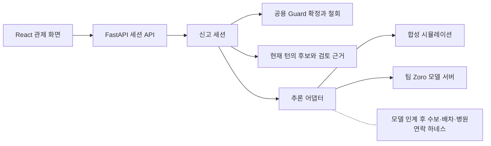

# 신고 턴과 판단을 연결하는 로컬 관제 데모 설계

## 범위와 선택

제품·연동 담당은 서울 합성 신고의 텍스트 재생, 태스크별 판단, 가상 차량·병원 후보, 근거·이력과 모의 출동을 구현한다. 첫 데모는 공용 하네스로 실행한다. 이후 팀원이 파인튜닝 산출물과 서빙 계약을 전달하면 제품·연동 담당이 체크포인트에 맞는 태스크별 하네스를 개발한다. [프로젝트 명세 §2–8](../../spec.md) · [화면 기준](../../../DESIGN.md)

| 대안 | 바뀌는 코드와 비용 |
| --- | --- |
| 한 FastAPI 앱 안에서 세션, 추론, 후보 조회를 모듈로 나누고 모델은 별도로 서빙 | 세션 하나에서 정정과 모의 출동을 일관되게 처리한다. 모델 교체 시 서빙과 태스크별 특화 하네스를 먼저 검증하고, 공용 판단 계약과 화면에 미치는 영향을 통합 테스트에서 확인한다. **추천안** |
| 유형·긴급도·차량·병원별로 API부터 화면까지 묶기 | 개별 카드 개발은 쉽다. 출동유형 정정이 차량·병원을 함께 철회하므로 실제로는 공통 상태 관리자와 여러 기능 모듈을 함께 변경한다. |
| 기능별 서비스를 독립 배포하기 | 독립 배포가 필요한 팀에는 유리하다. 두 명이 만드는 로컬 데모에서는 정정 한 건에도 여러 서비스의 버전과 이력을 동기화해야 한다. |

## 모듈과 변경 책임

| 소유 위치 | 책임과 의존 방향 |
| --- | --- |
| `backend/api.py` | FastAPI 라우팅, 요청 검증, 도메인 결과를 공개 DTO와 HTTP 상태로 변환. 앱을 조립할 때 세션 서비스와 어댑터를 연결한다. |
| `backend/sessions.py` | 신고·턴·진행 중 요청·모의 출동을 관리한다. 출동유형·긴급도에 이어 후속 후보 판단을 요청하고 공용 Guard의 결과와 실행 상태를 묶어 제공한다. |
| 공용 `decision_guard.py` | `advance → begin → apply`로 판단 확정·보류·철회를 단독 소유하고 `active/history`를 제공한다. 35개 기존 테스트와 공개 호출 경로를 첫 구현의 기준으로 삼는다. |
| `backend/inference.py` | `decide(현재 입력, 질문들)` 계약을 구현한다. 합성 실행기와 Zoro HTTP 호출이 같은 계약을 제공한다. 실시간 모드만 모델 목록을 조회하고 typed decision을 요청한다. |
| 역할별 전문 하네스 | 모델 인계 후 추론 경계에 연결한다. 수보·배차·병원연락 역할별 입력 템플릿, 후보 순서와 head 라벨 매핑, 점수 해석, 추가 보류 정책과 반례 회귀 테스트를 담당한다. |
| `backend/scenarios.py` 및 후보 자료 공급 함수 | 서버에만 전체 시나리오를 보관한다. 현재 턴까지 공개된 발화·검토 근거와 차량·병원별 후보 스냅샷을 제공한다. 후보 자료에는 가용 여부·ETA·출처·시각을 담는다. 외부 NMC·Tmap 어댑터는 이후 이 경계에 연결한다. |
| `frontend/src/api.ts`, 세션 제어 훅, 관제 뷰 | API 코드는 전송과 DTO, 훅은 재생·선택·낡은 응답 폐기, 뷰는 화면 구성과 조작만 담당한다. 컴포넌트가 후보를 재선정하거나 확정 여부를 계산하면 테스트 실패로 본다. |

## 호출 계약과 실패 처리

- 시나리오 목록, 세션 생성·조회, 이벤트 적용을 제공한다. 생성 시 `simulation` 또는 `live`를 명시한다. 이벤트는 다음 발화, 직접 입력, 재시도, 모의 출동이다. 초기화는 새 세션 UUID를 만든다. 브라우저는 세션 ID와 현재 입력 버전을 함께 보낸다.
- 이벤트는 입력 반영 후 `202`와 새 버전·처리 상태를 즉시 돌려준다. 모델 연산이 남으면 브라우저가 세션을 조회한다. 조회와 정정은 이전 연산 종료를 기다리지 않는다. 처리 완료 후 조회를 멈춘다.
- API 응답에는 세션·턴·입력 버전·화면 갱신 번호, 실행 모드, 대화, 후보·출처·시각, 네 태스크의 상태·선택·근거·실행 오류·이력을 담는다. 실시간 태스크에는 사용한 모델의 표시 이름을 함께 제공한다. 출처가 확인된 지침이 없으면 빈 참조를 돌려준다. 합성 실행의 확률은 화면에 표시하지 않는다.
- 모델 입력에 시나리오 ID로 접근 가능한 전체 데이터, 검토 정답, 다음 턴을 포함하지 않는다. 직접 입력으로 전환하면 기존 시나리오 근거를 철회한다. 독립적으로 검토된 근거가 없는 자유 입력은 네 태스크 모두 보류하며, 재생을 다시 시작할 때 새 세션을 사용한다.
- 합성 선택은 서버 내부의 해당 턴 전용 fixture에서 제공한다. 실시간 어댑터에는 이 자료를 넘기지 않는다. 이번 버전에서는 직접 입력에 검토 근거를 부여하는 별도 입력원이 없으므로 모델 호출을 건너뛴다.
- 후보 공급자는 태스크별 비교에 쓰이는 전체 사실을 동일 세션의 `CandidateVersionTracker`에 한 번 넘긴다. 여기서 얻은 번호 한 개를 하네스, 진행 중 요청, 이력에서 함께 사용한다. 원천 시각은 출처 메타데이터다. 모델과 하네스에는 같은 적격 ID 집합, 화면에는 미상·불가를 포함한 전체 후보를 준다. 병원 원천 오류가 차량 추천을 철회하지 않는다.
- 병원 조회가 실패하면 직전 값은 저장 자료로 표시하고 시각을 붙인다. 갱신되지 않은 후보는 적격 목록에서 제외한다. 병원 조회 재시도는 병원 자료와 그 판단만 갱신하고 이미 채택된 차량 판단을 유지한다.
- 요청 전 세션 잠금 안에서 입력 버전을 검사하고 현재 입력과 티켓을 확보한다. 서로 다른 두 변경이 같은 버전을 제시하면 하나만 적용되고 다른 쪽은 409와 재조회 안내를 받는다. 모델 I/O 동안 잠금을 해제한다. 결과를 적용하기 직전에 세션·입력 버전·후보 버전·티켓의 일치 여부와 해당 후보의 가용성·정보 유효시각을 다시 확인한다. 오래된 응답은 사유만 기록하고 현재 판단을 유지한다. 먼저 출동유형과 긴급도를 검토하고, 후속 판단은 각각 시작 조건이 갖춰지면 진행한다.
- 단계당 총 요청 예산 5초는 기존 하네스의 기본 만료와 맞춘 로컬 기본값이다. 연결 제한은 1초, 남은 시간 안에서 목록 조회와 추론을 마친다. 오류는 실행 상태에 표시하고 대기·재시도를 제공한다. 숫자는 제품 성능 측정 결과와 별도다.
- 화면은 선택한 세션과 갱신 번호를 검사해 늦은 응답을 무시한다. 초기화 전 요청은 예전 세션에서만 완료될 수 있다. 모의 출동은 세션당 1회이며 현재 확정된 차량만 적용한다. 중복·재시도·이후 추천 변경으로 실제 적용 차량이 달라지지 않는다.
- 새 정정은 앞선 작업의 티켓을 무효화한다. 작업 종료 시 성공·오류·취소 모두 진행 중 표시를 해제하되, 후속 작업의 표시를 지우지 않는다. 세션 용량 초과 응답은 `session_capacity`와 `Retry-After`를 포함한다.

## 모델 인계와 실행 환경

모델 서버에서 가중치를 로드한다. 팀원에게 체크포인트 종류(전체·decision head·adapter), 베이스 모델·토크나이저 revision, 태스크별 head 라벨 순서, 학습·서빙 템플릿과 점수 의미, 로딩 방법, 서버 주소·모델 ID, 합성 대표 입력과 기대 출력을 받는다. 전달 파일의 체크섬을 팀 인계 기록과 대조한다.

첫 데모는 `ZORO_BASE_URL`과 필요 시 모델 ID 하나로 시작한다. 인계 후에는 역할·태스크마다 엔드포인트, 모델 ID, 체크포인트 revision, head와 adapter를 연결한다. 하나의 모델을 세 역할이 공유할 수 있고 필요한 역할만 다른 조합을 쓸 수 있다. 같은 단계에서 실제 연결 조합이 같고 요청 입력이 호환되는 태스크만 한 번에 호출한다. 서버의 `GET /v1/models`가 광고한 단일 ID 또는 정확히 일치하는 설정 ID를 선택한다. `POST /v1/systemone` 시간 초과와 형식 오류는 해당 태스크의 실행 오류로 표시한다.

단일 프로세스, 메모리 세션, 루프백 주소로 실행한다. 30분 이상 유휴 상태이고 진행 중 요청이 없는 세션만 정리한다. 128개가 사용 중이면 새 세션에 503을 반환한다. 감사 이력은 세션 안에 두고 일반 오류 로그에는 신고 원문·인증값을 넣지 않는다. 공용 배포와 제출용 실모델 로그는 이후 단계다.

## 모델 인계 후 특화 하네스

SFT 검증은 출동유형과 긴급도부터 시작한다. 차량과 병원은 실제 학습 내역과 호환성을 확인한 뒤 원본 또는 파인튜닝 head를 사용하고 태스크별로 기록한다. [프로젝트 명세 §6](../../spec.md#6-데이터와-학습)

| 역할 | 입력과 근거 | 허용 출력과 경계 | 대표 반례 |
| --- | --- | --- | --- |
| 수보요원 Zoro | 현재까지 공개된 근거 발화, 검토된 신고 사실과 근거 턴. 검토 정답 라벨은 공용 Guard에만 전달한다. | `dispatch`는 출동유형, `urgency`는 긴급도를 각각 제안하거나 보류한다. 입력 근거가 있는 태스크부터 처리한다. | 출동유형 근거만 있으면 긴급도는 보류한다. 신고가 정정되면 정정된 사실을 뒷받침하던 이전 근거 ID를 무효화하고 그 응답을 폐기한다. |
| 배차요원 Zoro | 확정된 구급 유형, 근거가 있는 위치, 현재 적격 차량 ID와 가용 여부·역량·ETA | `vehicle`에 현재 후보 ID 하나를 제안하거나 보류한다. 모의 출동 적용은 세션이 별도 조작으로 처리한다. | 가용 목록이 그대로여도 ETA 순위가 뒤집히면 새 후보 버전으로 판단한다. 이전 버전의 차량 응답은 폐기하고 이미 적용된 모의 출동은 보존한다. |
| 병원연락 Zoro | 확정된 구급 유형, 근거가 있는 위치, 현재 적격 병원 ID와 검토된 수용 정보·ETA·출처·시각 | `hospital`에 현재 후보 ID 하나를 제안하거나 보류한다. 선택 시 연락 전에 확인할 항목을 출처와 함께 템플릿에 표시할 수 있다. 실제 통화와 수용 확정은 앱 범위 밖이다. | 저장 응답만 남거나 수용 정보가 미상이면 해당 후보를 확정하지 않는다. 조회 실패 중에도 차량 후보는 판단할 수 있다. |

세션은 역할 사이에서 검증한 구조화 사실과 근거 참조, 세션·턴·입력 버전과 태스크별 후보 버전만 전달한다. 모델이 추정한 증상·위치·병원 수용 상태를 다른 역할의 검토 근거로 올리지 않는다. 공용 Guard가 구급을 확정하고 위치를 검토하면 차량과 병원은 서로 독립적으로 판단한다. 긴급도 보류나 병원 조회 실패도 배차를 막지 않는다.

**전달 예시.** 2턴에서 구급이 확정되고 위치가 검토되면 세션은 두 역할에 같은 턴·근거를 전달하고 각자의 후보 버전을 붙인다. 배차는 차량 A를 제안하고 병원연락은 조회 실패로 보류한다. Guard가 A를 확정한 뒤 운영자가 모의 출동을 적용한다. 3턴에 위치가 정정되면 Guard는 앞선 추천을 철회하고 늦은 병원 응답은 폐기한다. 이미 적용된 모의 출동 기록은 유지된다.

- `PASS`는 정상 형식의 후보를 공용 Guard에 넘긴다는 뜻이다. 최종 확정은 Guard가 결정한다. 추가 보류는 근거 부족과 같은 정상 판단이다. 매핑 실패나 형식 오류는 실행 오류로 표시한다.
- 현재 요청의 추가 보류는 기존 확정을 철회해야 한다. 오래된 요청의 보류는 최신 판단에 영향을 주지 않는다. 명시적 보류 이벤트가 필요하면 모델 수령 후 공용 인터페이스 변경을 별도 검토한다. 현재 `apply`는 모델 응답을 검증하며 전용 보류 이벤트는 설계 사항이다.
- 모델 인수 시 체크섬과 대표 합성 입력의 라벨 매핑을 먼저 대조한다. 파일 신원을 확인할 수 없으면 실시간 SFT 선택을 미검증으로 표시한다. 개발셋에서 짧은 발화의 과신, 정정 뒤 같은 오답 반복, 후보 나열 순서만 바꿨을 때의 선택 변화를 찾고 재현한 사례를 회귀 테스트로 보존한다. 인수·회귀 예시는 최종 평가셋과 분리한다.
- 비교는 `Base + 공용`, `SFT + 공용`, `같은 SFT + 특화 + 공용` 세 조건에서 한다. 세 조건의 현재까지 발화, 후보와 순서, 실행 환경을 맞춘다. 개발셋에서 템플릿과 보류 정책을 고르고 평가 기준과 반복 횟수를 평가 전에 고정한다. 개발·평가 표본은 분리한다. 학습 표본과 통화·시나리오 단위 중복을 확인하기 전에는 일반화 판단을 보류한다.
- 조기 오확정률, 긴급도 하향 오판률, 채택률, 턴별 p95 지연과 표본 수를 기록한다. 실행 시 확인한 모델 ID와 모델별·태스크별 head, 템플릿, 하네스, 보류 정책 revision을 함께 남긴다. 실제 가중치와 보류 임계값은 인계와 개발셋 검증을 거쳐 정한다.

## 검증 기준

1. HTTP와 브라우저에서 정보 부족 → 차량 확정·병원 대기, A/B ETA 역전, 병원 소스 timeout 세 시나리오를 재생한다. 자료 출처와 선택이 바뀐 턴을 화면에서 확인한다.
2. 두 요청의 완료 순서를 뒤집어 정정 전 응답과 초기화 전 응답을 검사한다. 동일 입력 버전의 중복 이벤트와 동일 세션의 중복 모의 출동을 검증한다.
3. 로컬 모델 서버 대역으로 모델 ID 검색, typed 요청, 잘못된 응답과 시간 초과를 검사한다. 가짜 응답을 실모델 실행 증거로 사용하지 않는다.
4. 첫 데모에서는 합성 어댑터와 로컬 모델 서버 대역을 연결해 같은 세션·UI 계약을 확인한다. 병원 버전만 바꿔 차량 판단이 유지되는지, 후보 버전이 어긋난 응답이 폐기되는지 검사한다.
5. 기존 하네스 테스트, 새 API 테스트, 프론트 프로덕션 빌드와 실제 브라우저의 데스크톱·좁은 화면 조작을 각각 실행한다.
6. 모델 인계 후 역할별 반례와 전체 전달 흐름을 합성 시나리오로 재현한다. 수보는 긴급도 하향 오판과 근거 전 확정, 배차는 가용 해제 차량 추천, 병원연락은 수용 정보가 미상인데 확정으로 표시되는 사례를 검사한다. 라벨·후보 순서 역전, 잘못된 점수, 현재 요청의 보류와 늦은 보류도 확인한다. 특화 하네스 효과는 동일한 체크포인트·head에 공용 하네스만 붙인 조건과 비교한다. 세 비교 조건을 같은 평가 표본에서 재현하고 세션·UI 계약도 다시 확인한다.
